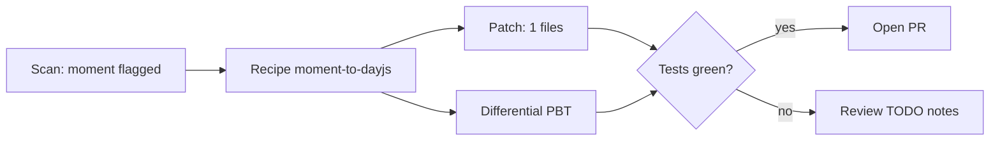

# Design: Migrate moment to dayjs

## Approach

Apply the curated `moment-to-dayjs` recipe: a deterministic source transform, a `package.json` edit. Verification is differential: the old and new implementations run side by side under fast-check.

## Flow

## Known limits

- moment mutates in place, dayjs is immutable: mutating calls whose result is discarded are flagged with a TODO, not rewritten.
- moment-timezone, locales and custom parsing formats need manual review (flagged with TODOs).
- Differential tests cover format, add/subtract, startOf/endOf, diff, comparison and ISO parsing for pure date maths; they do not prove plugin behaviour such as relativeTime wording.

## Files changed

- `src/time.js`

