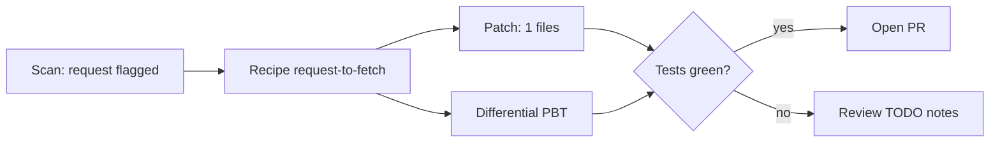

# Design: Replace request with native fetch

## Approach

Apply the curated `request-to-fetch` recipe: a deterministic source transform, a `package.json` edit, and 1 added file(s) (lib/request-compat.cjs). Verification is differential: the old and new implementations run side by side under fast-check.

## Flow

## Known limits

- The shim covers the common callback API: uri/url, method, qs, headers, body, json, form, auth, timeout, followRedirect, encoding: null, plus get/post/put/patch/del/head/defaults.
- Streams and .pipe(), cookie jars, multipart, proxies and nested qs objects are not supported; call sites are flagged with TODOs.
- fetch refuses WHATWG bad ports (for example 1, 25, 6000); the shim then probes the socket and reports its error code, or ERR_BLOCKED_PORT if the port is open.
- Differential tests run both clients against a local HTTP server; they do not cover TLS, redirects across hosts or retry behaviour.

## Files changed

- `src/http-client.js`
- `lib/request-compat.cjs` (new)
